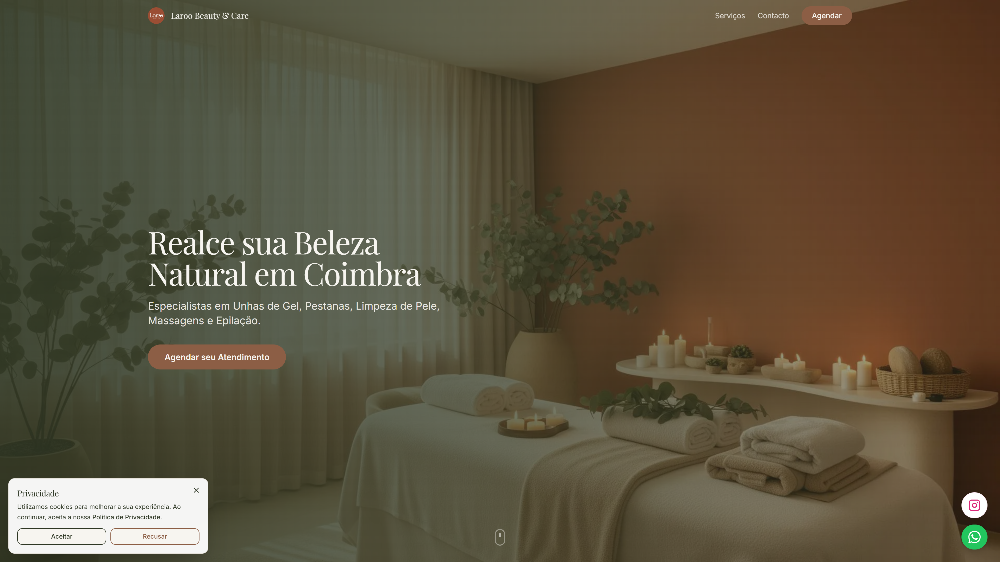
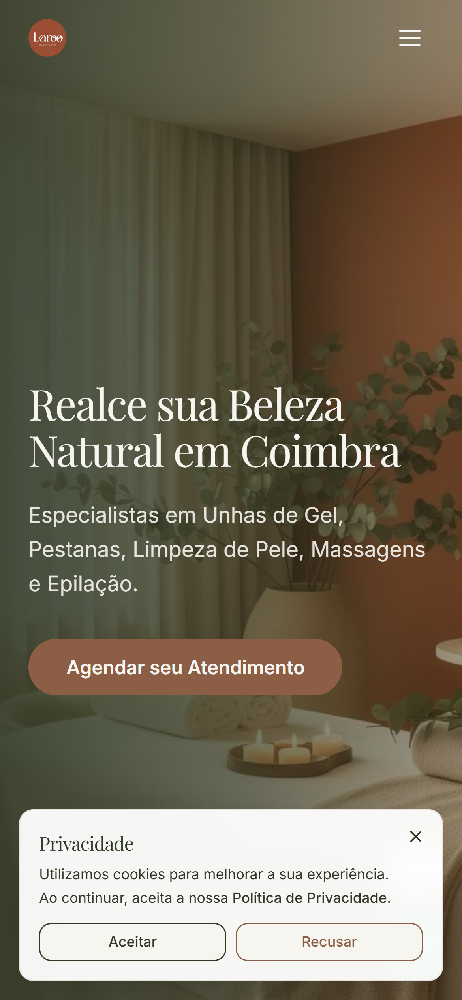

# 🌿 Laroo Beauty & Care

**Website Institucional & Plataforma de Agendamentos**

*"Beleza natural, experiência sensorial."*

  <a href="https://laroo-beauty-care.vercel.app/" target="_blank"><strong>🌐 Visitar Website Oficial</strong></a> •
  <a href="https://alexandracarneiro.tech/" target="_blank"><strong>💼 Portfólio da Desenvolvedora</strong></a>

---

## 📖 Sobre o Projeto

O **Laroo Beauty & Care** é um espaço de estética e bem-estar localizado em **Coimbra, Portugal**, dedicado a tratamentos de alto padrão em unhas, pestanas, cuidados faciais e terapias corporais.

Este projeto consistiu no desenvolvimento sob medida de uma aplicação web institucional focada em **alta conversão**, desenhada para valorizar a identidade visual da marca, apresentar o portfólio de serviços de forma sensorial e descomplicar a jornada de agendamento de clientes através de canais diretos (WhatsApp).

### 💡 Destaques do Desenvolvimento:
- **Engenharia com Apoio de IA:** Aceleração de rotinas de codificação, refinamento de componentes reutilizáveis e otimizações avançadas de SEO e performance.
- **Validação com a Proprietária:** Ciclos contínuos de alinhamento estético, tipografia, tom de voz e cartela de cores diretamente com a proprietária do estúdio.
- **Arquitetura Moderna & Escalável:** Construído com React, TypeScript e Tailwind CSS, integrado a um pipeline de CI/CD automatizado na plataforma Vercel.

---

## 📸 Demonstração Visual

### 💻 Versão Desktop

### 📱 Versão Mobile Responsiva

---

## 🎨 Identidade Visual & Design System

A estética do projeto foi concebida para transmitir calma, pureza, sofisticação e conexão com a natureza:

### 🎨 Paleta de Cores Oficial

| Cor | Código Hex | Uso Principal |
| :--- | :--- | :--- |
| **Verde Musgo Profundo** | \`#4A5240\` | Títulos principais, botões primários, rodapé e acentos estruturais |
| **Terracota Aveludado** | \`#AD8A72\` | Destaques sutis, ícones, estados de hover e badges |
| **Bege Areia / Pedra** | \`#D9CFC4\` | Divisórias, bordas de cards e elementos neutros |
| **Off-White / Creme** | \`#F7F5F0\` | Fundo principal da página (proporciona leitura calorosa e suave) |
| **Branco Puro** | \`#FFFFFF\` | Superfícies de cards e caixas de leitura |

### ✍️ Tipografia
- **Títulos & Headlines:** *Playfair Display* (Serifada) — confere elegância atemporal e sofisticação editorial.
- **Corpo & Navegação:** *Inter* (Sans-serif) — garante máxima legibilidade, clareza e ritmo moderno em qualquer dispositivo.

---

## 🛠️ Stack Tecnológica

| Camada | Tecnologias Utilizadas |
| :--- | :--- |
| **Core & Framework** | [React 18](https://react.dev/) + [TypeScript](https://www.typescriptlang.org/) + [Vite (SWC)](https://vitejs.dev/) |
| **Estilização & UI** | [Tailwind CSS](https://tailwindcss.com/), Radix UI Primitives, Lucide React, Framer Motion |
| **Formulários & Dados** | React Hook Form, Zod, TanStack React Query |
| **Performance & SEO** | Vite Plugin Image Optimizer (Sharp), React Helmet Async, Sitemap e Metatags Open Graph |
| **Hospedagem & CI/CD** | [Vercel](https://vercel.com/) (Deploy contínuo acionado a cada push no Git) |
| **Privacidade & Métricas** | Google Analytics com Cookie Banner integrado em conformidade com o **RGPD** |

---

## 💎 Funcionalidades Principais

- **✨ Vitrine Visual de Serviços:** Apresentação clara de procedimentos (Unhas de Gel, Extensão de Pestanas, Limpeza de Pele, Massagens Relaxantes) com valores-base para qualificação de leads.
- **📲 Conversão Direta via WhatsApp:** Chamadas para ação (CTA) inteligentes que abrem o canal de contato do estúdio com mensagens pré-formatadas para o serviço desejado.
- **🎯 Sticky Navbar com Glassmorphism:** Barra de navegação fixa com efeito translúcido para acesso instantâneo a menus, localização e botão de reserva.
- **🍪 Banner de Cookies (RGPD):** Gerenciamento ético de consentimento para ativação de scripts analíticos.
- **📱 Responsividade Impecável:** Interface com foco *Mobile-First*, garantindo experiência tátil agradável em smartphones, tablets e desktops.

---

## 📂 Estrutura de Diretórios

\`\`\`bash
laroo-beauty-care/
├── public/                 # Favicons, sitemap, manifest e fotos estáticas
├── screenshots/            # Capturas de demonstração para o README
├── src/
│   ├── assets/             # Imagens e ícones otimizados
│   ├── components/         # Componentes modulares (Navbar, Hero, Services, Footer, UI)
│   ├── data/               # Dados estáticos de serviços, preços e depoimentos
│   ├── hooks/              # Custom hooks para comportamento de UI e cookies
│   ├── lib/                # Utilitários de estilização (cn, tailwind-merge)
│   ├── pages/              # Páginas da aplicação (Home, NotFound)
│   ├── App.tsx             # Roteamento e estrutura principal
│   └── main.tsx            # Ponto de entrada da aplicação React
├── tailwind.config.ts      # Configuração de temas, cores oficiais e fontes
├── package.json            # Dependências e scripts do projeto
└── vite.config.ts          # Configuração do bundler Vite
\`\`\`

---

## 🚀 Como Executar Localmente

### Pré-requisitos
- [Node.js](https://nodejs.org/) (versão 18+) ou [Bun](https://bun.sh/)
- Gerenciador de pacotes (npm, pnpm ou bun)

### Passo a passo:

1. **Clonar o repositório:**
   \`\`\`bash
   git clone https://github.com/alexandra-carneiro/laroo-beauty-care.git
   cd laroo-beauty-care
   \`\`\`

2. **Instalar dependências:**
   \`\`\`bash
   npm install
   \`\`\`

3. **Executar o servidor de desenvolvimento:**
   \`\`\`bash
   npm run dev
   \`\`\`
   Acesse a aplicação no navegador em \`http://localhost:5173\`.

4. **Gerar build de produção:**
   \`\`\`bash
   npm run build
   \`\`\`

---

## 👩‍💻 Autoria & Créditos

Projeto desenvolvido com foco em excelência visual e código limpo por **Alexandra Carneiro**:

- **GitHub:** [@alexandra-carneiro](https://github.com/alexandra-carneiro)
- **LinkedIn:** [carneiro-alexandra](https://www.linkedin.com/in/carneiro-alexandra/)
- **Portfólio:** [alexandracarneiro.tech](https://alexandracarneiro.tech/)

*Direitos de marca e imagem reservados a **Laroo Beauty & Care** (Coimbra, Portugal).*
